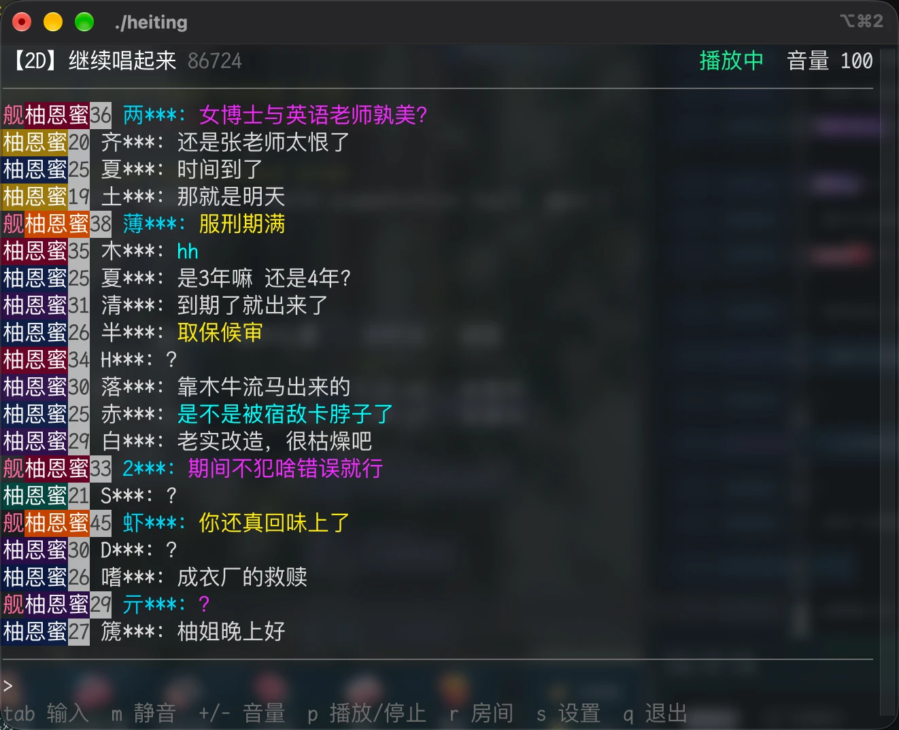

# 黑听 HeitingCLI

在终端里听 B 站直播：播放直播间音频、看弹幕、发弹幕。




## 安装

```bash
go install github.com/di404/HeitingCLI/cmd/heiting@latest
```

## 使用

```bash
heiting                                # 打开房间列表，选择后进入
heiting 7777                           # 按房间号打开
heiting https://live.bilibili.com/7777 # 按链接打开
```

### 按键

| 按键 | 功能 |
| --- | --- |
| `tab` | 切换到弹幕输入 / 返回 |
| `m` | 静音 |
| `+` `-` | 调节音量 |
| `p` | 播放 / 停止 |
| `r` | 房间列表 |
| `s` | 设置 |
| `↑` `↓` `j` `k` `PgUp` `PgDn` 鼠标滚轮 | 滚动弹幕 |
| `q` | 退出 |

### 房间列表

开播的房间排在最前面。`a` 添加（房间号或链接），`d` 删除，`r` 刷新，`n` 切换匿名模式，`enter` 进入。

### 设置

按 `s` 打开，修改后立即生效并自动保存。

- 音频：进房时播放、音量、缓冲秒数
- 弹幕：缓存条数、彩色弹幕、舰长标识、粉丝牌名称和等级
- 界面：显示直播标题、显示房间号
- 网络：User-Agent
- 账号：匿名模式、扫码登录、退出登录

未登录时不能发送弹幕，部分用户名会被 B 站打码。


## 文件位置

| 文件 | macOS | Linux |
| --- | --- | --- |
| 配置和登录状态 | `~/Library/Application Support/heiting/` | `~/.config/heiting/` |
| 日志和登录二维码 | `~/Library/Caches/heiting/` | `~/.cache/heiting/` |


## 许可证

[MIT](LICENSE)

